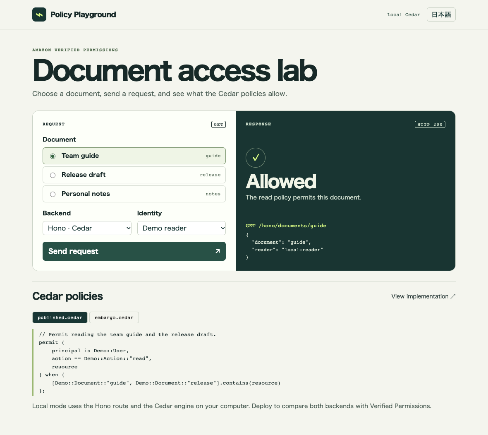

# Verified Permissions Playground

[English](./README.md) · 日本語 · [ブラウザーで試す](https://yuu551.github.io/verified-permissions-playground/)

文書を選んでリクエストを送ると、HTTP の応答と対応する Cedar ポリシーを見比べられます。公開デモでは Hono と Cedar の WebAssembly エンジンがブラウザー内で動きます。AWS にデプロイすると、Hono と FastAPI の両方から Amazon Verified Permissions に問い合わせて、同じポリシーの判定を比較できます。

[](https://yuu551.github.io/verified-permissions-playground/)

## 3つの文書で判定を試す

画面右上の **日本語** を押してください。ユーザーに **デモユーザー** を選び、文書を切り替えて **リクエストを送る** を押すと、次の結果を確認できます。

| 文書 | 応答 | 理由 |
| --- | --- | --- |
| チームガイド | 200 | 閲覧を許可するポリシーが適用されます。 |
| リリース草稿 | 403 | 閲覧を許可するルールと明示的な禁止が両方適用され、禁止が優先されます。 |
| 個人メモ | 403 | 閲覧を許可するポリシーがありません。 |

**匿名** に切り替えて同じリクエストを送ると、認証が必要なため 401 が返ります。プレビューではサンプルのユーザーを使います。AWS 上の文書 API にアクセスするには、Cognito の ID トークンが必要です。

## 手元で動かす

Node.js 24.12 以降と npm があれば、次のコマンドで起動できます。

```sh
git clone https://github.com/yuu551/verified-permissions-playground.git
cd verified-permissions-playground
npm ci
npm run dev
```

ブラウザーで [localhost:4173](http://127.0.0.1:4173/) を開いてください。`policies/` のファイルを書き換えてサーバーを再起動すると、自分のルールを試せます。この手順では AWS の認証情報は使いません。

## AWS CDK でデプロイする

CDK でリソースを作成できる AWS 認証情報と、Python 3.13 の Lambda をパッケージングするための [uv](https://docs.astral.sh/uv/getting-started/installation/) を用意してください。リポジトリで `npm ci` を済ませ、次のコマンドを実行します。

```sh
export AWS_REGION=us-east-1
export AWS_DEFAULT_REGION=us-east-1
# このアカウントとリージョンで初めて CDK を使う場合
npm run build
npx cdk bootstrap
npm run deploy
npm run demo:user
```

最後のコマンドで閲覧用ユーザーが作成され、URL、ユーザー名、生成されたパスワードがターミナルに表示されます。URL を開き、**日本語** を選んでから **サインイン** を押してください。サインイン後は **バックエンド** で Hono と FastAPI を切り替え、3つの文書の判定を比較できます。ID トークンはメモリに保持するので、ページを再読み込みするとサインインし直せます。

この構成では、API Gateway の Regional **REST API** がルートパスで画面を配信します。文書取得メソッドにはネイティブ JWT オーソライザーを設定しています。API Gateway は Cognito の発行元、アプリクライアントの audience、RS256 署名を検証し、選択したバックエンドの Lambda を呼び出します。Lambda が閲覧可否を問い合わせる先は、どちらも同じポリシーストアです。[構成図の編集用ファイル](./docs/architecture.drawio) · [REST API の JWT オーソライザー](https://docs.aws.amazon.com/apigateway/latest/developerguide/rest-api-jwt-authorizer.html)


この構成を `us-east-1` にデプロイし、実際のブラウザーから両方のバックエンドで上記の4通りの応答を確認しました。

### リクエストを実装から追う

| ファイル | 確認できること |
| --- | --- |
| [Hono のルート](./api/hono/documents.mjs) · [Lambda の設定](./api/hono/handler.mjs) | パスの ID を文書リソースに対応づけ、ID トークンを認可エンジンに渡します。 |
| [FastAPI のルート](./api/fastapi/handler.py) | 同じアクションと文書リソースを依存関数で指定し、`token="identityToken"` で認可します。 |
| [許可ポリシー](./policies/published.cedar) · [禁止ポリシー](./policies/embargo.cedar) | 草稿にはどちらも適用されるため、明示的な禁止が優先されます。 |
| [CDK スタック](./infra/app.mjs) | 文書取得メソッド、JWT の発行元と audience、ポリシーストア、Lambda の IAM 権限を定義しています。 |

利用しているライブラリは、それぞれ単独でも導入できます。[Hono 版](https://github.com/yuu551/hono-verified-permissions) · [FastAPI 版（PyPI）](https://pypi.org/project/fastapi-verified-permissions/)

## テストと後片付け

```sh
npm test
npx playwright install chromium
npm run test:ui
npm run test:aws
npm run destroy
```

AWS の画面テストはデプロイ時の出力を読み込み、一時的な閲覧用ユーザーで両方のバックエンドの 200・403・401 を確認します。テストが終わると一時ユーザーを削除します。AWS にデプロイしたリソースには通常の利用料金がかかります。`npm run destroy` で、このスタックの API、Lambda、ポリシーストア、ユーザープール、ロググループを削除できます。CDK のブートストラップで作成した共有リソースは別に管理されます。

[Apache License 2.0](./LICENSE)
