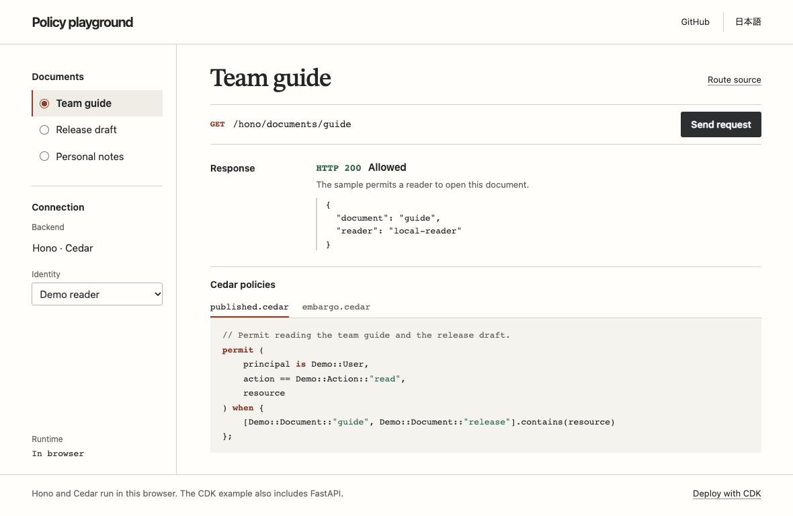

# Verified Permissions Playground

English · [日本語](./README.ja.md) · [Open the playground](https://yuu551.github.io/verified-permissions-playground/examples/policy-playground/)

Try a document request, inspect the HTTP response, and read the Cedar policies that explain it. The hosted demo runs Hono and the Cedar WebAssembly engine in your browser. On AWS, try Hono on Lambda Web Functions or compare Hono and FastAPI behind API Gateway. Both deployments use Amazon Verified Permissions.

[](https://yuu551.github.io/verified-permissions-playground/examples/policy-playground/)

## Try three documents

Opening the browser demo sends a request for the team guide. Select another document and click **Send request** to compare its HTTP response with the Cedar source below. The **日本語** button switches the interface language.

| Document | Reader | Why |
| --- | --- | --- |
| Team guide | 200 | A permit policy covers this document. |
| Release draft | 403 | An explicit forbid overrides the matching permit. |
| Personal notes | 403 | No permit matches this document. |

Select **Anonymous** and send the request again to get 401. The preview identity is a local fixture. In the AWS deployment, protected routes require a Cognito ID token.

## Run locally

With Node.js 24.12 or later and npm installed, run

```sh
git clone https://github.com/yuu551/verified-permissions-playground.git
cd verified-permissions-playground/examples/policy-playground
npm ci
npm run dev
```

Open [localhost:4173](http://127.0.0.1:4173/). Edit the files under `policies/` and restart the server to try your own rules. The local preview uses the Hono library and the same Cedar source as the cloud deployment. No AWS account is required for this step.

## Deploy Hono on Lambda Web Functions

The Web Function serves the playground and its Hono routes over one HTTPS endpoint. Sign in with Cognito to get an ID token. Hono verifies the token's signature, user pool, app client, expiration and token use. The document route then sends the token, action and document ID to Amazon Verified Permissions. [HTTP server](./api/hono/web-function.mjs) · [CDK stack](./infra/web-function.mjs)


After `npm ci`, select a supported AWS Region. Bootstrap CDK once per account and Region if needed.

```sh
export AWS_REGION=us-east-1 AWS_DEFAULT_REGION=us-east-1
# First CDK deployment in this account and Region
npm run web:build
npx cdk bootstrap --app "node infra/web-function.mjs"

npm run web:deploy
npm run web:user
```

Open the URL printed by `npm run web:user` and sign in with the generated reader. Try the team guide, release draft and personal notes, then select **Anonymous**. To repeat those checks with a temporary user and remove the billable sample stack afterward, run these commands.

```sh
npx playwright install chromium
npm run web:test
npm run web:destroy
```

This stack uses Node.js 24. To compare Hono with FastAPI, use the REST API stack below. [Editable diagram](./docs/web-function.drawio) · [AWS Lambda Web Functions](https://docs.aws.amazon.com/lambda/latest/dg/web-functions.html)

## Deploy with AWS CDK

Use an AWS account where you can deploy CDK resources, AWS credentials, and [uv](https://docs.astral.sh/uv/getting-started/installation/) for packaging the Python 3.13 Lambda. Start in the cloned repository after `npm ci`. The commands below target `us-east-1`.

```sh
export AWS_REGION=us-east-1
export AWS_DEFAULT_REGION=us-east-1
# First deployment with CDK in this account and region
npm run build
npx cdk bootstrap
npm run deploy
npm run demo:user
```

The last command creates a reader and prints the application URL, username and generated password in your terminal. Open the URL, click **Sign in**, and use those credentials. Switch **Backend** between **Hono** and **FastAPI** and repeat the three requests. The browser keeps the ID token in memory. Reloading the page signs you out.

The stack runs a Regional API Gateway **REST API**. The public root returns the UI. Each document method uses the native JWT authorizer with the Cognito issuer, app client audience and RS256. After API Gateway verifies the token, the selected Lambda calls `IsAuthorizedWithToken` on the shared policy store. The diagram follows a protected request. [Editable diagram](./docs/architecture.drawio) · [AWS REST API JWT authorizers](https://docs.aws.amazon.com/apigateway/latest/developerguide/rest-api-jwt-authorizer.html)


We deployed this stack in `us-east-1` and verified all four cases in a browser against each backend.

### Follow a request in code

| Source | What to look for |
| --- | --- |
| [Hono route](./api/hono/documents.mjs) · [AWS authorization engine](./api/hono/cloud.mjs) | The middleware maps the path parameter to a document and passes the ID token to the AWS engine. |
| [FastAPI route](./api/fastapi/handler.py) | The same action and resource appear in a FastAPI dependency using `token="identityToken"`. |
| [Permit](./policies/published.cedar) · [Forbid](./policies/embargo.cedar) | Both statements apply to the release draft. The forbid wins. |
| [CDK stack](./infra/app.mjs) | Follow the two protected methods, issuer and audience, policy store and Lambda permissions. |

The deployed adapters are available separately. [Hono](https://github.com/yuu551/hono-verified-permissions) · [FastAPI on PyPI](https://pypi.org/project/fastapi-verified-permissions/)

## Verify and clean up

```sh
npm test
npx playwright install chromium
npm run test:ui
npm run test:aws
npm run destroy
```

The local tests cover the preview. The AWS browser test reads the deployment outputs, creates a temporary reader, checks 200, 403 and 401 on both backends, and deletes its reader afterward. Running the cloud sample incurs normal AWS charges. Destroying the stack removes its API, functions, policy store, user pool and log groups. The shared CDK bootstrap resources have their own lifecycle.

[Apache License 2.0](../../LICENSE)
